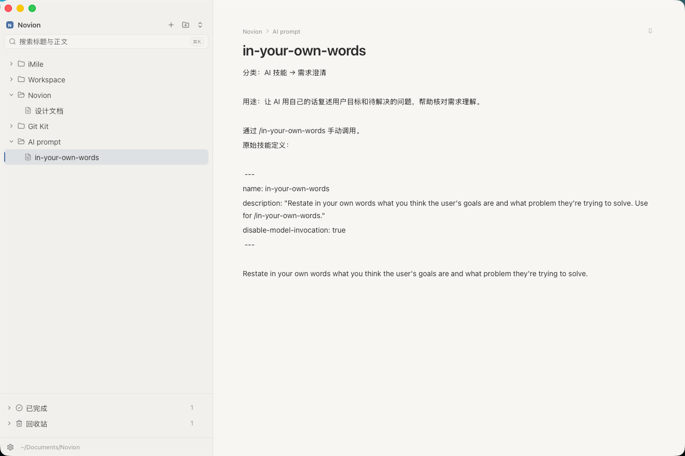

# Novion

一款本地优先的桌面笔记应用。使用类似 Notion 的块编辑体验，所有笔记默认以纯 JSON 保存在本机，轻量、安静、无需登录。



## 功能

- 块编辑器：标题、列表、待办、代码块、引用、图片等常用内容块
- 文档树：文件夹、拖拽排序、置顶、已归档和回收站
- 快速搜索：按 `⌘K` 搜索标题和正文
- 本地优先：数据默认保存在 `~/Documents/Novion`
- 低内存占用：基于 Tauri 复用 macOS 系统 WebView，不内置 Chromium；编辑器按需加载
- 存储切换：支持本机与 iCloud 云盘之间的数据迁移和合并
- Notion 同步：将本地工作区中的文件夹和文档镜像到 Notion

## 存储与 iCloud

Novion 默认使用本机存储，也可以通过 iCloud 云盘在多台 Mac 之间同步完整工作区。

1. 在 macOS 系统设置中登录 iCloud，并开启“iCloud 云盘”。
2. 打开 Novion 的 `设置` → `存储`，选择切换到 iCloud 云盘。
3. 如果本机和 iCloud 都已经有数据，可以选择：
   - **合并两边数据（推荐）**：同一文档保留较新版本，另一版本保存为“（本机副本）”。
   - **只用 iCloud 数据**：本机原数据会先备份为 `Novion.backup-时间戳`。
   - **只用本机数据**：iCloud 原数据会先备份，然后由本机内容覆盖。
4. 切换完成后，所有读写都会使用 iCloud 目录，多台 Mac 会自动同步。

iCloud 同步是文件级的：两台 Mac 同时编辑同一篇文档时，以最后写入的版本为准。

## Notion 同步

Novion 支持单向同步到 Notion，本地内容会写入 Notion，Notion 上的修改不会回写到本地。

1. 在 Notion 中创建一个内部 Integration，并复制生成的 Token。
2. 在目标页面右上角打开 `...` → `连接`，添加并授权刚才创建的 Integration。
3. 打开 Novion 的 `设置` → `Notion`，粘贴 Token 并验证保存。
4. 粘贴目标 Notion 页面链接，设为同步目标。
5. 选择同步方式后手动开始同步：
   - **只同步新增的**：跳过已同步的文档，不改动 Notion 上的编辑。
   - **全部重写已同步的正文**：覆盖本地已修改文档在 Notion 中的正文。

同步时，文件夹会转换为子页面，文档会转换为页面；也可以选择是否包含“已归档”中的内容。

## 技术栈

- React 18 + TypeScript + Vite
- Tauri v2 + Rust
- TipTap / ProseMirror
- Tailwind CSS v4 + Zustand

## 开发

环境要求：Node.js 20+、pnpm、Rust 1.77+、macOS 11+ 和 Xcode Command Line Tools。

```bash
pnpm install
pnpm app:dev
```

## 构建

```bash
pnpm app:build
open release/Novion-debug.app
```

构建生成 macOS debug 应用，并自动收集到 `release/Novion-debug.app`。

## 数据目录

本机模式：

```text
~/Documents/Novion/
├── workspace.json
├── docs/
└── assets/
```

iCloud 模式：

```text
~/Library/Mobile Documents/com~apple~CloudDocs/Novion/
├── workspace.json
├── docs/
└── assets/
```

`workspace.json` 保存目录结构，`docs/` 保存文章 JSON，`assets/` 保存图片资源。
